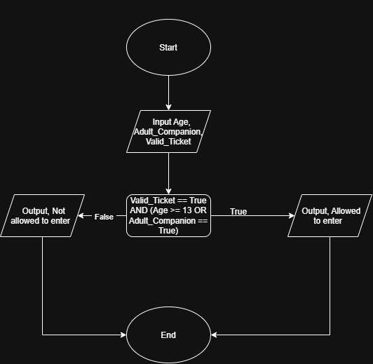

# Tutorial 1: Movie Theater Admission Policy

## 1 Identify the Components:

- **a) Inputs:**
  * `Age`: The age of the person.
  * `Adult_Companion`: Whether the person is accompanied by an adult (`True`/`False`).
  * `Valid_Ticket`: Whether the person holds a valid ticket (`True`/`False`).

- **b) Process:**
  * Evaluate the logical condition to check if the person holds a valid ticket **AND** is either 13 years old or older **OR** accompanied by an adult.

- **c) Output:**
  * Admission decision: `"Allowed to enter"` or `"Not allowed to enter"`.

---

## 2 Design the Algorithm:

### a) Diagram


### b) Truth Table

| Age >= 13 (A) | Adult Companion (B) | Valid Ticket (C) | (A OR B) | Final Admission Result |
| :--- | :--- | :--- | :--- | :--- |
| False | False | False | False | **False (Not Allowed)** |
| False | False | True | False | **False (Not Allowed)** |
| False | True | False | True | **False (Not Allowed)** |
| False | True | True | True | **True (Allowed)** |
| True | False | False | True | **False (Not Allowed)** |
| True | False | True | True | **True (Allowed)** |
| True | True | False | True | **False (Not Allowed)** |
| True | True | True | True | **True (Allowed)** |

### c) Step-by-Step Solution
1. Start the program.
2. Read the inputs: `Age`, `Adult_Companion`, and `Valid_Ticket`.
3. Check if `Valid_Ticket` is `False`. If so, output `"Not allowed to enter"` and go to Step 6.
4. Check if `Age >= 13` OR `Adult_Companion == True`. If so, output `"Allowed to enter"` and go to Step 6.
5. Otherwise, output `"Not allowed to enter"`.
6. End the program.

### d) Pseudocode
```text
START
    INPUT Age
    INPUT Adult_Companion
    INPUT Valid_Ticket

    IF Valid_Ticket == TRUE AND (Age >= 13 OR Adult_Companion == TRUE) THEN
        OUTPUT "Allowed to enter"
    ELSE
        OUTPUT "Not allowed to enter"
    ENDIF
END
